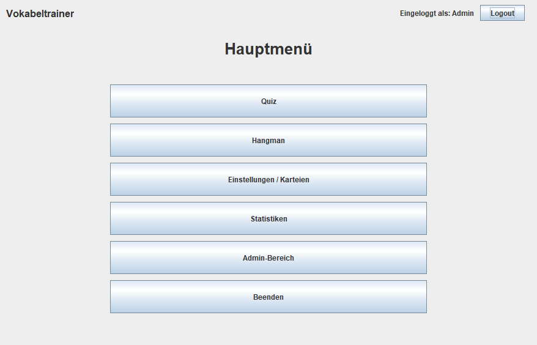
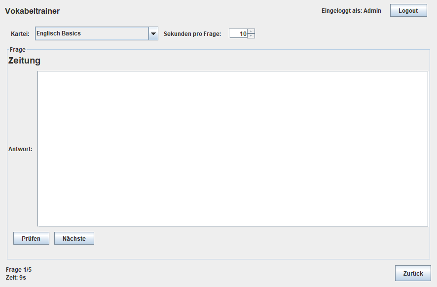

<div align="center">

# 🦸 VocabHero

**A vocabulary trainer with user accounts, your own word decks, a timed quiz and Hangman.**

[](https://github.com/PHaas09/VocabHero/actions/workflows/build.yml)


[](https://github.com/PHaas09/VocabHero/releases/latest)

 

</div>

## Features

- **Accounts:** register and log in. Every user has their own decks and statistics.
- **Decks:** create, edit and delete decks for the quiz (question → answer) or for Hangman (word list).
- **Quiz under time pressure:** you choose how many seconds you get per question.
- **Hangman** with the words from your own decks.
- **Statistics:** every quiz run is saved, so you can see your progress over time.
- **Admin area** for managing users.
- Everything is stored as plain text files in `data/`, so no database is needed.

## Run it

**Download:** get `VocabHero.zip` from the [latest release](https://github.com/PHaas09/VocabHero/releases/latest), unzip it and run this inside the folder:

```bash
java -jar VocabHero.jar
```

**From source (JDK 17+), run in the project folder:**

```bash
javac -d out src/*.java
java -cp out AppFrame
```

Log in with the demo account **`Admin` / `Admin1234!`**, which has two example decks, or register your own user.

## Structure

| Class | Job |
|---|---|
| `AppFrame` | Main window, switches between screens (`CardLayout`) |
| `UserManager` | Login, registration, user list (`data/users.txt`) |
| `DeckStore` | Loads and saves decks per user (`data/<user>/*.txt`) |
| `QuizEngine` / `QuizPanel` | Quiz logic and its screen with the timer |
| `HangmanEngine` / `HangmanPanel` | Hangman logic and its screen |
| `QuizStatsStore` / `StatsPanel` | Quiz history and statistics |
| `SettingsPanel`, `AdminPanel` | Deck editor and user management |

A UML diagram is in [`UML.asta`](UML.asta) (Astah).

> The UI is in German.
